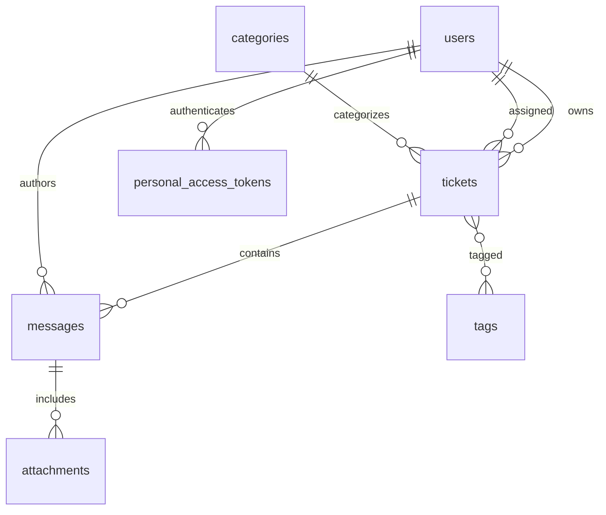

# Schema

Tickets are soft-deletable and indexed by status, priority, assignment, and reply/resolution timestamps. Attachments remain private on the local disk and are authorized through the ticket participant policy.
