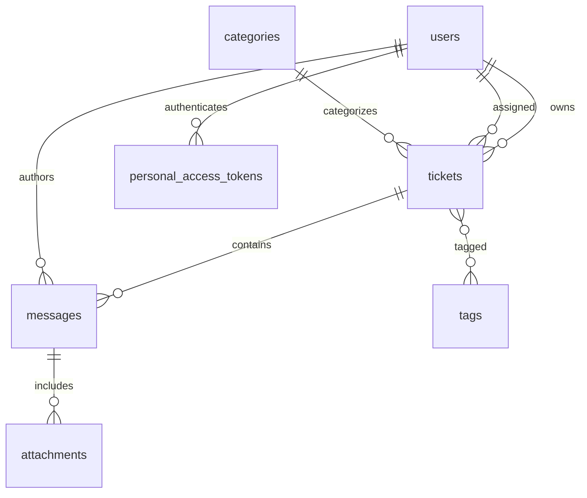

# Schéma de données

Les tickets utilisent la suppression logique et sont indexés par statut, priorité, assignation et dates de réponse/résolution. Les pièces jointes restent privées sur le disque local et leur accès est autorisé via la policy des participants du ticket.
